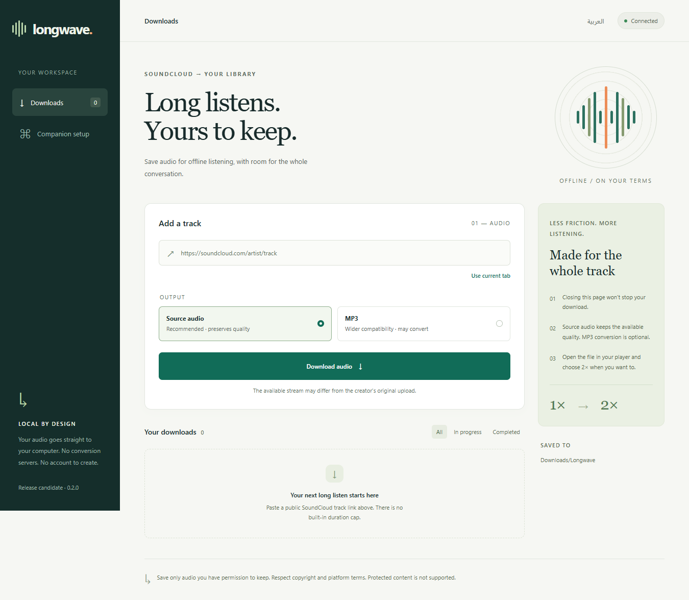

# Longwave

**Long listens. Local files.** An open-source SoundCloud browser extension with a local companion for saving public audio, including playable tracks without a native download button.

[دليل التشغيل بالعربية](docs/quickstart-ar.md)

Longwave keeps media processing on your computer. It downloads supported full-length streams, preserves the available source audio by default, and optionally converts to MP3 for external players.

**Status: 0.2.0 release candidate for Windows 10/11 x64.** A standalone setup package can be built and shared; users do not need Python, Node.js, or a source checkout. It uses unpacked browser installation. Publisher signing, store publication, and broader clean-machine validation remain release work. There is no application-imposed duration limit; source availability, disk space, and network conditions still apply.



## What works

- Popup and full downloads workspace, with English and Arabic/RTL interfaces.
- Full SoundCloud track links and `on.soundcloud.com` share links. Pasting the whole sharing message extracts its link.
- Public, unencrypted full audio streams; the native download flag is not required.
- A local queue with persistent state, progress, pause/resume, retry, cancellation, and output-folder reveal.
- A detached companion that continues after the extension page or browser closes.
- Source-format audio, or optional MP3 conversion. No whole-track PCM decoding in the browser.
- Conservative source validation before reusing partial downloads. Changed/expired signed links can require a restart.
- Output audio-stream and duration checks before atomic finalization.
- No telemetry, account integration, browser-cookie extraction, remote conversion service, or broad page permissions.

Source audio is the stream SoundCloud makes available, not necessarily the creator's uploaded master. Converting a lower-bitrate stream to MP3 cannot restore missing quality. Playback speed remains a feature of your local player; choose 2× there without changing the saved audio.

## Install the standalone candidate (Windows)

Extract `longwave-0.2.0-rc.1-windows-x64.zip` completely and open **Longwave-Setup.exe**. Choose an audio folder and install. Setup includes its own runtime, downloads checksum-verified media tools, and registers the companion for your account without administrator privileges.

Open **START-HERE.html** from the package. The candidate uses **Developer mode → Load unpacked**; the extension folder is in the installed version under `%LOCALAPPDATA%/Longwave/versions`. Keep that installed folder in place. Setup supports repair/update, rollback to the previous version, and disconnection that preserves audio/history.

This candidate is unsigned and is not published to browser stores. A public download URL will exist after the generated assets are uploaded to a repository release. Store-upload packaging is prepared separately and requires real store IDs. See [distribution details](docs/distribution.md).

See [candidate verification](docs/release-verification.md) for standalone-package and Chrome/Edge results, and [CHANGELOG.md](CHANGELOG.md) for changes.

## Develop from source (Windows)

Prerequisites: Node.js 22+, npm, Python 3.11+, and Chrome or Edge. Python 3.15 and Edge 158 were used for the local checks. The installer registers a per-user native host; it does not require administrator access.

Run these commands from the project directory in PowerShell:

```powershell
npm ci
npm run setup:media
python -m venv .venv
.\.venv\Scripts\python.exe -m pip install --require-hashes -r companion\requirements.txt
npm run build
.\.venv\Scripts\python.exe scripts\install_companion.py
```

`setup:media` downloads the pinned matching FFmpeg/ffprobe build used by the standalone installer. Downloads need network access and may take several minutes. Archive checksums and executable versions are checked. See [troubleshooting](docs/troubleshooting.md).

Then:

1. Open `edge://extensions` or `chrome://extensions`.
2. Enable Developer mode, choose **Load unpacked**, and select `dist/chromium`.
3. Open Longwave from the extensions toolbar. Its status should say **Connected**.
4. Paste a SoundCloud link, choose Source audio or MP3, and download.

The default output is `~/Downloads/Longwave`. Change it during setup:

```powershell
.\.venv\Scripts\python.exe scripts\install_companion.py --output "D:\Audio"
```

Use `--home` to choose a different companion data directory. Keep the source folder and `.venv` in place for this developer installation. Standalone users use the setup package above.

The extension key in `extension/public-key.json` is a public development identity, not a secret. It keeps the unpacked extension ID stable so the native host can allow exactly this extension. Public browser-store identities will need their own host allowlist entries.

## How it works

```text
TypeScript extension
       │ narrow, versioned Native Messaging commands
       ▼
Python native host ── SQLite job journal
                           │
                    detached supervisor
                           │ one job process at a time
                           ▼
                 SoundCloud adapter / yt-dlp
                           │ bounded fragment concurrency
                           ▼
                 disk-backed partial audio
                           │ FFmpeg + ffprobe
                           ▼
                    verified local output
```

The UI never receives audio bytes. The background worker forwards commands, while the companion owns durable state. Each job runs in its own process so cancellation releases extractor file handles on Windows. An OS lock prevents duplicate supervisors. A Windows Job Object ties child processes to their supervisor when available.

The adapter rejects previews, encrypted playlists, unsupported live/master playlists, and restricted access. It passes the exact validated HLS media playlist to the downloader. Three fragment requests may run at once; only one track is active. Read [architecture](docs/architecture.md) for recovery semantics and [source research](docs/research/soundcloud-source-feasibility.md) for the initial code review.

## Reliability and current limits

- **Resume is conditional.** An identical HLS source fingerprint or a validated direct-file identity permits partial reuse. If a signed URL or manifest changes, this preview restarts safely instead of guessing that fragments match. It retains old partial attempts.
- **Pause is cooperative.** An in-flight request can take up to its network timeout to stop. Conversion is stopped through its owned process.
- **Recovery after reboot requires reopening Longwave.** The companion has no system-startup registration. Opening the workspace reconciles active jobs and restarts the worker.
- **Keep free disk space.** Source, output, and earlier interrupted attempts can coexist. There is not yet an automatic partial-cache cleanup UI.
- **Queue:** up to 20 unfinished jobs; the workspace exposes up to 100 jobs with unfinished work prioritized. Single tracks only; playlists and bulk downloads are not implemented.
- **Formats:** supported clear MP3/AAC/M4A/Opus/Ogg sources. A supported stream is not guaranteed for every track. No DRM, subscription bypass, private-session extraction, or region circumvention.
- **Release scope:** matching FFmpeg/ffprobe 9.1 inputs are pinned and verified. The installer is unsigned; broader security/OS testing and store review remain requirements for a stable release.
- Some error explanations remain English when the interface is Arabic. Filesystem history is local; moving a finished file makes “Show in folder” unavailable.

## Development and verification

```powershell
npm run check          # strict TypeScript checks
npm test               # Python unit and real local-media integration tests
npm run build          # unpacked Chromium extension
npm run test:browser   # isolated headless Edge + real Native Messaging + accessibility
npm run format:check   # source/document formatting
npm run release:windows # setup, extension/store/source ZIPs, and checksums
npm run test:release   # actual ZIP without system Python/Node on PATH
```

Tests choose `.venv` when present. Integration tests generate their own sine-wave audio and serve it over loopback; no copyrighted recordings are in the fixtures. They exercise progressive transfer, HLS assembly, MP3 conversion, source preservation, pause/resume equivalence, framing, origin validation, and durable job transitions. Without yt-dlp or the media tools, the integration tests report explicit skips.

Browser tests use fresh, isolated Edge profiles under `.runtime/browser-smoke-*`; they do not access your normal tabs or history. The companion must be registered first. `npm run preview` serves a **simulated UI-only preview**; it cannot download audio and is never bundled into the extension.

For a read-only source check:

```powershell
.\.venv\Scripts\python.exe scripts\inspect_source.py "https://soundcloud.com/artist/track"
```

This prints sanitized metadata, not signed media URLs. See [verification evidence](docs/verification.md) for the tested scope and remaining work.

## Repository

```text
extension/src/          UI, browser adapter, protocol types, translations
extension/public/       HTML and styles
companion/longwave/      Native host, journal, source adapter, worker, audio engine
companion/tests/         Unit tests and generated-media integration tests
scripts/                Build, installation, browser tests, diagnostics
release/                Standalone installer, pinned inputs, native executable shim
docs/                   Architecture, research, verification, release plan
.github/workflows/      Build and test checks
```

See [CONTRIBUTING.md](CONTRIBUTING.md), [SECURITY.md](SECURITY.md), and [PRIVACY.md](PRIVACY.md).

## Disconnect or uninstall

Standalone users: run **Longwave-Setup.exe → Disconnect companion**, then remove the extension in the browser. Files and history are preserved. For developer installations, use the same `--home` used during installation:

```powershell
.\.venv\Scripts\python.exe scripts\install_companion.py --uninstall
```

This requests a pause, stops the supervisor after its current job stops, and removes only matching Longwave registry entries. Downloaded audio, history, and partial files are preserved. After the worker has exited, you may remove its data directory if you no longer want that data.

## Usage and licensing

Save only audio you own or have permission to retain. Respect copyright, licenses, and SoundCloud's terms. Public playback availability does not establish permission to download. Longwave does not bypass DRM, paywalls, or access controls and is not affiliated with SoundCloud.

Longwave's original source is [MIT-licensed](LICENSE). CPython, yt-dlp, FFmpeg, and development packages retain their own licenses. See [THIRD_PARTY_NOTICES.md](THIRD_PARTY_NOTICES.md). The standalone ZIP includes CPython and yt-dlp source with notices; setup obtains media tools directly from upstream. Native executables are excluded from Git and the browser extension archive.
